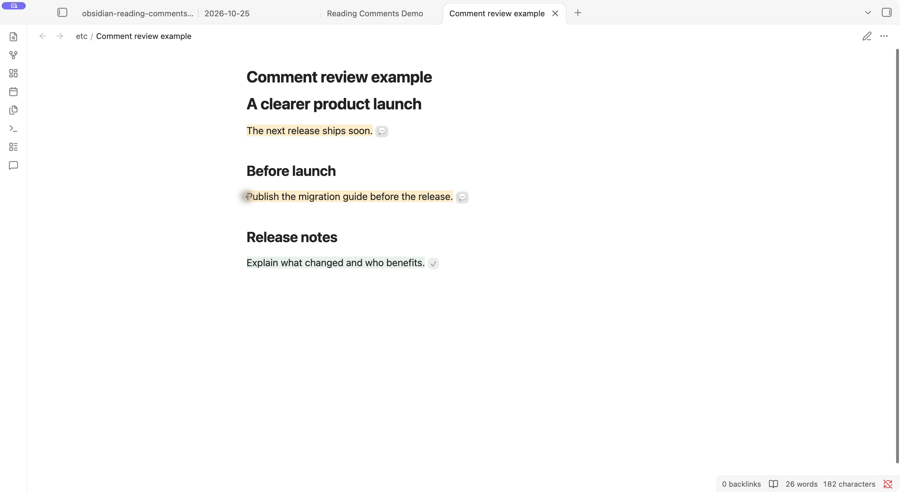
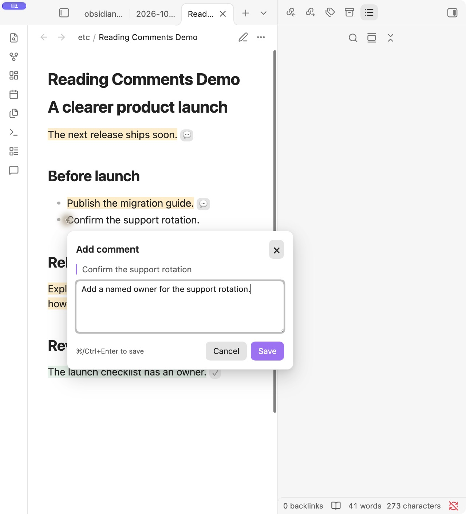

# Reading Comments for Obsidian

**Read a document. Leave comments. Let Claude or another LLM make the edits.**

Reading Comments lets you review a Markdown document in Obsidian’s **Reading view**, attach feedback to specific passages, and hand the whole review to Claude or another LLM. Comments stay separate from the document, so you can focus on reading before asking the AI to fix it.

[Download the latest release](https://github.com/hello1101n/obsidian-reading-comments/releases/latest) · [Report an issue](https://github.com/hello1101n/obsidian-reading-comments/issues) · [VS Code companion](https://github.com/hello1101n/comment-tool)

## Use case: review first, let the AI edit afterward

You have a draft, proposal, plan, or other document you want to improve. You want to read it comfortably and leave feedback where it belongs, then have an LLM turn that feedback into changes.

1. **Read the document** in Obsidian Reading view.
2. **Select passages and leave comments** such as “Explain this more clearly,” “Add a concrete example,” or “Replace this vague deadline with a date.”
3. **Finish your review**, then click **Copy review prompt** in the comments sidebar.
4. **Give the prompt to Claude or another LLM** with access to the document and its comments file. Ask it to apply the feedback.
5. **Read the updated document** in Obsidian. Processed comments become **Resolved** when the AI saves their statuses. Reopen any comment that needs another attempt.

For example, highlight “The next release ships soon,” comment “Replace ‘soon’ with 30 October,” and hand the review to your AI agent. The agent updates that sentence and marks the comment resolved.



**Desktop only.** Comments are created in Reading view. Live Preview, source mode, and mobile are outside this release.

## Install

This plugin is installed manually; it is not listed in Obsidian’s community plugin directory. **You do not need Node.js or a build tool to install the release.**

1. Download [reading-comments-0.1.3.zip](https://github.com/hello1101n/obsidian-reading-comments/releases/download/v0.1.3/reading-comments-0.1.3.zip) from the [release page](https://github.com/hello1101n/obsidian-reading-comments/releases/latest). Choose the plugin ZIP, not GitHub’s “Source code” archives.
2. Extract it. The resulting `reading-comments` folder should contain `main.js`, `manifest.json`, and `styles.css`.
3. Open your Obsidian vault’s `.obsidian/plugins/` directory. You can use the **Open plugins folder** folder icon in **Settings → Community plugins**. If navigating manually, show hidden folders to find `.obsidian`, and create `plugins` if it is missing.
4. Copy the extracted `reading-comments` folder into `plugins`. The final layout should be:

   ```text
   <your-vault>/.obsidian/plugins/reading-comments/
   ├── main.js
   ├── manifest.json
   └── styles.css
   ```

5. Return to **Settings → Community plugins**, click **Reload plugins**, and enable **Reading Comments**. Restart Obsidian if it does not appear.
6. Open a Markdown document and switch to **Reading view** using the view toggle in the note header.
7. Highlight some text. A small comment popup opens beside the passage with its text field focused; start typing.

Requires Obsidian **1.8.0 or newer** on desktop. The core workflow has been tested in Obsidian **1.14.5 on macOS**.

## Add your first comment

1. Highlight a passage in Reading view. A small popup opens beside the passage as soon as you finish selecting, with the comment field already focused. Start typing immediately.
2. Write your feedback, then choose **Save comment** or press **Cmd+Enter** / **Ctrl+Enter**.
3. Use **Escape**, **Cancel**, or a click outside the popup to cancel a draft.

Saving leaves the comments panel as it is: closed stays closed, and an open panel updates in place. Open it when you want using a comment marker, the message icon in the ribbon, or the **Reading Comments: Open reading comments** command.

<details>
<summary>See the comment composer</summary>



</details>

## Open and Resolved

| Status | Meaning |
| --- | --- |
| **Open** | Waiting to be processed. New comments and older comments without a status start here. |
| **Resolved** | Already processed. The comment is kept as review history. |

**Resolved means processed, even if the result was incorrect or the attempt failed.** Use **Reopen** whenever you want another pass. You can also resolve comments manually.

The sidebar provides **Show passage**, **Resolve/Reopen**, **Edit**, and **Delete**. Commenting and changing statuses do not modify the note’s Markdown.

## Send your comments to Claude or another LLM

1. Choose **Copy review prompt** in the sidebar.
2. Paste it into Claude Code or another AI agent that can read and edit files in your vault.
3. Let the agent process the review. Obsidian picks up saved note and status changes automatically.

If you use a chat-based LLM without local file access, also attach or paste the Markdown document and its `.comments` JSON file. Local paths alone will not give the model access. Save its revised Markdown and updated comments JSON back to the same files to see the edits and statuses in Obsidian.

The copied prompt includes absolute paths to the note and its comments file. It instructs the agent to:

1. Process only open comments, in stored order.
2. Apply each request while preserving unrelated content.
3. Set that comment’s `resolved` field to `true` immediately after the attempt, including unsuccessful attempts.
4. Preserve the comment text, IDs, and other JSON data.
5. Leave unprocessed comments open if the review stops early.
6. Summarize what happened, including failures.

The plugin does not call an AI service. Processing and status updates depend on the agent following the prompt and saving its changes. **Copy review prompt** is disabled when no open comments remain.

## Your notes stay portable

Reviews are stored in a vault-root `.comments` folder that mirrors your notes:

```text
Your vault/
├── docs/
│   └── proposal.md
└── .comments/
    └── docs/
        └── proposal.md.comments.json
```

Each comment records its selected text, line hints, feedback, ID, creation time, and optional resolution status and surrounding context. The version 1 JSON format is compatible with the VS Code Comment Tool; existing fields are preserved on updates. Use this plugin’s prompt when you want resolution-aware AI processing.

The plugin makes no network requests. If your vault uses a sync service, include `.comments` in that service’s configuration if you want reviews synced too.

## Passage tracking and current limits

1. Unique quotes are found again after surrounding text changes. Repeated quotes use saved context; ambiguous or missing passages remain listed for manual review.
2. When an AI rewrites the quoted passage, the original quote stays in the comment’s history. Its highlight may disappear because the old text is gone.
3. Note and folder moves performed **inside Obsidian** move the corresponding review files. Conflicting destinations are preserved and reported. Moves performed externally while Obsidian is closed require moving the review files and updating their `source` paths manually.
4. Obsidian renders long notes in sections. A passage may not have a visible marker until its section is rendered.
5. Embedded notes are excluded from selection capture to avoid attaching feedback to the wrong file.
6. In-plugin saves are serialized and stale edits are rejected. Separate applications writing the same review at exactly the same time can still race.
7. Invalid JSON is preserved and reported. Repair or restore it, then choose **Refresh**.

## Build and test

Use Node.js **24 or newer**:

```sh
git clone https://github.com/hello1101n/obsidian-reading-comments.git
cd obsidian-reading-comments
npm ci
npm test
npm run build
```

The installable plugin files are written to `dist/reading-comments/`.

The test suite covers DOM selections, status persistence, storage conflicts, malformed JSON, renames, and refresh races. A simulated Obsidian host uses real temporary files. The core workflow has also been checked in the native app; see [verification coverage](docs/verification.md).

## Uninstall

Disable **Reading Comments** and remove `<your-vault>/.obsidian/plugins/reading-comments`. Your notes remain ordinary Markdown. Keep `.comments` to retain your review history.
