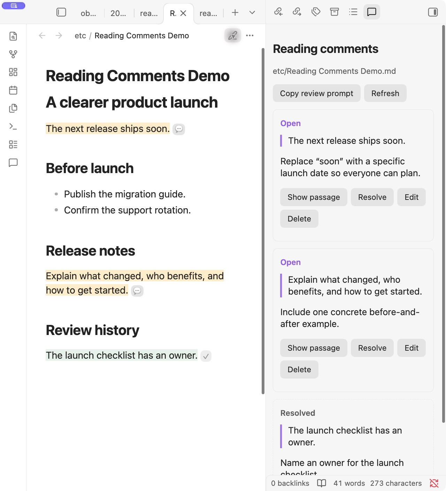
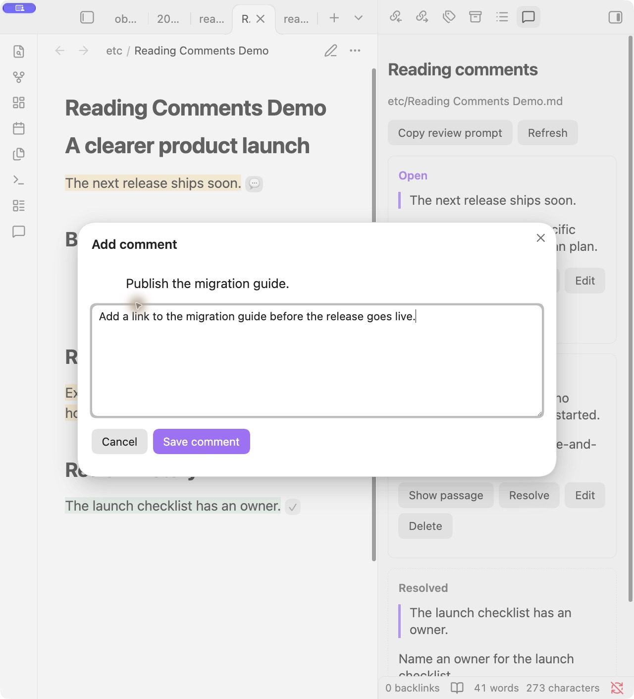

# Reading Comments for Obsidian

**Review the note you’re reading. Keep the feedback out of your Markdown.**

Reading Comments adds passage comments to Obsidian’s **Reading view**. Select text, write feedback, and revisit it through highlights, comment markers, and a sidebar. When you’re ready, copy a review prompt for an AI agent with access to your local files.

[Download the latest release](https://github.com/hello1101n/obsidian-reading-comments/releases/latest) · [Report an issue](https://github.com/hello1101n/obsidian-reading-comments/issues) · [VS Code companion](https://github.com/hello1101n/comment-tool)



## What you can do

1. Comment on paragraphs, formatted text, lists, and table cells while reading.
2. Jump between highlighted passages and their sidebar cards.
3. Edit, delete, resolve, or reopen comments.
4. Keep reviews across restarts and note renames.
5. Hand open comments to an AI through a copied prompt.
6. Share the same review files with the VS Code [Comment Tool](https://github.com/hello1101n/comment-tool).

**Desktop only.** Comments are created in Reading view. Live Preview, source mode, and mobile are outside this release.

## Install

This plugin is installed manually; it is not listed in Obsidian’s community plugin directory.

1. Download `reading-comments-0.1.0.zip` from the [latest release](https://github.com/hello1101n/obsidian-reading-comments/releases/latest).
2. Extract it. You should get a folder named `reading-comments` containing `main.js`, `manifest.json`, and `styles.css`.
3. Copy that folder into `<your-vault>/.obsidian/plugins/`.
4. In Obsidian, open **Settings → Community plugins**, reload the installed plugin list, and enable **Reading Comments**.
5. Open a Markdown note and switch to **Reading view**.

If the plugin does not appear, restart Obsidian. Obsidian **1.8.0 or newer** is required; the core workflow has been tested in Obsidian **1.14.5 on macOS**.

## Add your first comment

1. Select a passage in Reading view.
2. Click **Add comment**.
3. Write your feedback, then choose **Save comment** or press **Cmd+Enter** / **Ctrl+Enter**.
4. Use **Escape** to cancel a draft.

The comments sidebar opens after saving. Open it again with the message icon in the ribbon or the **Reading Comments: Open reading comments** command.

<details>
<summary>See the comment composer</summary>



</details>

## Open and Resolved

| Status | Meaning |
| --- | --- |
| **Open** | Waiting to be processed. New comments and older comments without a status start here. |
| **Resolved** | Already processed. The comment is kept as review history. |

**Resolved means processed, even if the result was incorrect or the attempt failed.** Use **Reopen** whenever you want another pass. You can also resolve comments manually.

The sidebar provides **Show passage**, **Resolve/Reopen**, **Edit**, and **Delete**. Commenting and changing statuses do not modify the note’s Markdown.

## Hand the review to an AI

1. Choose **Copy review prompt** in the sidebar.
2. Paste it into an AI coding agent that can read and edit files in your vault.
3. Let the agent process the review. Obsidian picks up saved note and status changes automatically.

The copied prompt includes absolute paths to the note and its comments file. It instructs the agent to:

1. Process only open comments, in stored order.
2. Apply each request while preserving unrelated content.
3. Set that comment’s `resolved` field to `true` immediately after the attempt, including unsuccessful attempts.
4. Preserve the comment text, IDs, and other JSON data.
5. Leave unprocessed comments open if the review stops early.
6. Summarize what happened, including failures.

The plugin does not call an AI service. Processing and status updates depend on the agent following the prompt and saving its changes. **Copy review prompt** is disabled when no open comments remain.

## Your notes stay portable

Reviews are stored in a vault-root `.comments` folder that mirrors your notes:

```text
Your vault/
├── docs/
│   └── proposal.md
└── .comments/
    └── docs/
        └── proposal.md.comments.json
```

Each comment records its selected text, line hints, feedback, ID, creation time, and optional resolution status and surrounding context. The version 1 JSON format is compatible with the VS Code Comment Tool; existing fields are preserved on updates. Use this plugin’s prompt when you want resolution-aware AI processing.

The plugin makes no network requests. If your vault uses a sync service, include `.comments` in that service’s configuration if you want reviews synced too.

## Passage tracking and current limits

1. Unique quotes are found again after surrounding text changes. Repeated quotes use saved context; ambiguous or missing passages remain listed for manual review.
2. When an AI rewrites the quoted passage, the original quote stays in the comment’s history. Its highlight may disappear because the old text is gone.
3. Note and folder moves performed **inside Obsidian** move the corresponding review files. Conflicting destinations are preserved and reported. Moves performed externally while Obsidian is closed require moving the review files and updating their `source` paths manually.
4. Obsidian renders long notes in sections. A passage may not have a visible marker until its section is rendered.
5. Embedded notes are excluded from selection capture to avoid attaching feedback to the wrong file.
6. In-plugin saves are serialized and stale edits are rejected. Separate applications writing the same review at exactly the same time can still race.
7. Invalid JSON is preserved and reported. Repair or restore it, then choose **Refresh**.

## Build and test

Use Node.js **24 or newer**:

```sh
git clone https://github.com/hello1101n/obsidian-reading-comments.git
cd obsidian-reading-comments
npm ci
npm test
npm run build
```

The installable plugin files are written to `dist/reading-comments/`.

The test suite covers DOM selections, status persistence, storage conflicts, malformed JSON, renames, and refresh races. A simulated Obsidian host uses real temporary files. The core workflow has also been checked in the native app; see [verification coverage](docs/verification.md).

## Uninstall

Disable **Reading Comments** and remove `<your-vault>/.obsidian/plugins/reading-comments`. Your notes remain ordinary Markdown. Keep `.comments` to retain your review history.
